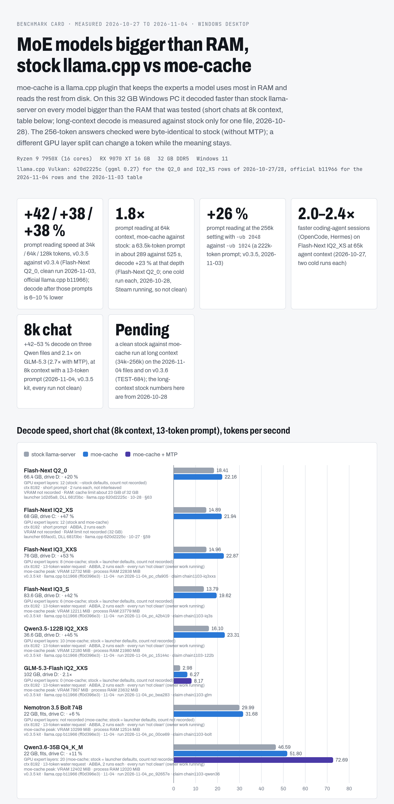

<h1 align="center">moe-cache</h1>

<p align="center"><b>Run Mixture-of-Experts models that are bigger than your RAM, without the speed cliff.</b><br>
A plugin for an unmodified <code>llama-server</code>. No fork, no patch.</p>

<p align="center">


<a href="https://ko-fi.com/ibrumm"></a>
</p>

<p align="center"><a href="docs/benchmark_card.html"><picture><source media="(prefers-color-scheme: dark)" srcset="docs/benchmark_card-dark.png"></picture></a></p>
<p align="center"><sub>Windows desktop, 32 GB RAM + 16 GB graphics card; speeds measured 2026-10-27/28 and, for six rows, 2026-11-04 with the v0.3.5 kit (each row lists its test details; not recorded values say so). Full <a href="docs/benchmark_card.html">benchmark card</a> (long context, other models, agents); every number in <a href="docs/RESULTS.md">docs/RESULTS.md</a>. Older laptop results: <a href="docs/RESULTS.md#laptop-results-older-versions">docs/RESULTS.md</a>.</sub></p>

## What it is

**moe-cache lets a normal PC run big Mixture-of-Experts AI models** (files of 60-120 GB) that are bigger than its RAM, with the **same answers as plain llama.cpp**: token-identical below 128k context with the same layer split; from 128k context a q8_0 KV cache is used (`--exact` keeps f16), MTP and the `--fast` modes can change answers; see [EXACTNESS](docs/EXACTNESS.md). Chat in your browser, or connect coding tools (OpenCode, Hermes, Claude Code). Windows 11 and Linux. Free (MIT), no account.

MoE models (Qwen3, GLM, gpt-oss, DeepSeek) use only a few "experts" per token. When the file is bigger than your RAM, plain llama.cpp keeps reading the whole file from the disk and slows to a crawl; moe-cache keeps the experts the model actually uses in RAM and reads only the rest. If your model already fits in RAM, plain llama.cpp is as fast or faster, and moe-cache steps aside on its own ([when to use something else](docs/FAQ.md#when-to-use-something-else)).

| You need | |
|---|---|
| Memory | 32 GB RAM for the big models (16 GB works for smaller ones such as Qwen3.6-35B); a graphics card is optional but recommended |
| Disk | an SSD (NVMe is best) with the model size plus about 10 GB free |
| Software | Python 3.8 or newer (3.11 or newer for `connect codex --write`, which checks the merged TOML file). llama.cpp is included in the Windows kit and the Linux `-ggml0.26` download (v0.3.3 and newer) |
| Time | about 10 minutes of setup, plus the model download |

**Privacy:** no telemetry, no account; the plugin opens no network connections. The few times the launcher or installer uses the internet (downloads you ask for, the update check) are listed in [docs/SECURITY.md](docs/SECURITY.md#privacy-what-moe-cache-sends-and-stores).

## Get started

### Quickest: one line, then `moe-cache launch`

| | Install (checks the download against the release's SHA256 file; no admin or root; undo with `-Uninstall` / `--uninstall`) |
|---|---|
| Windows PowerShell | `irm https://github.com/IbrahimSiddiqui007/moe-cache/releases/latest/download/install.ps1 \| iex` (needs Python 3.8+; 3.11+ only for `connect codex --write`; it says how to get it if missing) |
| Linux | `curl -fsSL https://github.com/IbrahimSiddiqui007/moe-cache/releases/latest/download/install.sh -o install.sh && sh install.sh` |

Then open a new terminal and run `moe-cache launch`: it checks your PC, suggests models that fit, prints the download command (it downloads only after you say yes), starts the server and offers to connect your coding agents. What it asks, step by step: [docs/INSTALL.md](docs/INSTALL.md#terminal-guide-moe-cache-launch). The manual ways follow.

### Windows 11

| Step | What to do |
|---|---|
| 1. Python | Python 3.8 or newer from python.org (tick "Add python.exe to PATH") |
| 2. The kit | Download `moe-cache-vX-windows-x64.zip` (the newest) from [Releases](https://github.com/IbrahimSiddiqui007/moe-cache/releases). Right-click it > Properties > tick **Unblock** > OK, then unzip it, e.g. to `C:\moe-cache`. The kit is not code-signed: if Windows says "protected your PC", click More info > Run anyway |
| 3. A model | In the kit folder: `python bin\moe_cache.py pick` names the model that suits your PC and prints its download command (needs `pip install -U huggingface_hub` once). Or skip the command: the control page (step 4) has **Settings > Download a model**, which downloads from the catalogue with a progress bar, continues a cut download and checks the sha256 at the end |
| 4. Run | Double-click `moe-cache.bat`: the control page opens; pick the model, press Start. The first start takes a minute or two |
| 5. Agents | Tick Agent mode, then the page's Connect buttons (Hermes, OpenCode) |

If something is off, `python bin\moe_cache.py check D:\models\model.gguf` says what to fix. Every install option: [docs/INSTALL.md](docs/INSTALL.md#windows-quick-start-experimental); Windows details: [docs/WINDOWS.md](docs/WINDOWS.md).

**Using the PC while the model runs?** Tick **Leave room for me** on the control page (or `--leave-room`): the model leaves more RAM, GPU memory and CPU to your own programs and gets a little slower. A CPU with its own graphics: plug the monitor into the motherboard. The GPU also draws your desktop, and the screen flickers or the browser stutters while a long prompt runs? Reserve GPU memory for it with `--gpu-margin GiB` (for example `--gpu-margin 3`): the launcher plans fewer expert layers on the GPU and leaves that much free. Without the option it already keeps more free when other programs hold GPU memory at start.

### Linux

| Step | What to do |
|---|---|
| 1. Download | From [Releases](https://github.com/IbrahimSiddiqui007/moe-cache/releases): `moe-cache-vX-ggml0.26-linux-x86_64.tar.gz` (llama.cpp b12064 included, Vulkan + CPU), or `moe-cache-vX-linux-x86_64.tar.gz` for an older llama.cpp of your own (ggml 0.24 / 0.25). `tar xzf` it and `cd` into the folder |
| 2. A model | `python3 bin/moe_cache.py pick` |
| 3. Check | `bin/moe-cache-check /path/to/model.gguf --run` ("cache runs: yes" means it works on your machine) |
| 4. Run | `bin/moe-cache-server /path/to/model.gguf --open` (chat page and an OpenAI-compatible API at http://localhost:8080), or `bin/moe-cache-server --ui` for the control page |

Which file on the Releases page:

| Your PC | File | Contains |
|---|---|---|
| Windows | `moe-cache-vX-windows-x64.zip` | the kit: plugin, launcher, llama.cpp b12064 (Vulkan) |
| Linux, no llama.cpp of your own, or ggml 0.26 or newer | `moe-cache-vX-ggml0.26-linux-x86_64.tar.gz` | plugin, launcher, llama.cpp b12064 (Vulkan + CPU) |
| Linux, your own older llama.cpp (ggml 0.24 / 0.25) | `moe-cache-vX-linux-x86_64.tar.gz` | plugin and launcher only |

Your own llama.cpp (CUDA, ROCm), `install.sh`, building from source, the speed options (`--fast`, `--hybrid`) and proving the output yourself: [docs/INSTALL.md](docs/INSTALL.md).

### Coding agents

Start the server in agent mode (or let on-demand start it when an agent asks), then point the agent at it. One command writes the agent's config; the old config is kept as `.bak`.

```bash
python3 bin/moe_cache.py on-demand /path/to/model.gguf --install-autostart   # loads the model on the first request, unloads it when idle
# or by hand: bin/moe-cache-server /path/to/model.gguf --agent                # context 65536, tool calls, API key, warm sessions
```

#### Hermes Agent

| Step | What to do |
|---|---|
| Install | Hermes Agent CLI, or Hermes Desktop on Windows (hermes-agent.nousresearch.com). Windows: add `%LOCALAPPDATA%\hermes\bin` to PATH so `connect` finds `hermes` |
| Connect | `python3 bin/moe_cache.py connect hermes --write` (or the control page's **Connect Hermes** button): provider `custom`, URL, model name, context 65536 and the API key go into Hermes' `config.yaml`. Hermes Desktop reads the same file |
| Use | `hermes chat` (CLI), `hermes dashboard` (web UI), or Hermes Desktop: Settings > Model shows the moe-cache model |
| Measured | Windows desktop, Flash-Next IQ2_XS (68 GB, bigger than RAM), a recorded Hermes bug-fix session: **81.6 s with moe-cache vs 163.9 s stock (2.0x)**, first token 21.8 vs 66.2 s ([RESULTS section 60](docs/RESULTS.md)) |

#### OpenCode

| Step | What to do |
|---|---|
| Install | OpenCode CLI, or OpenCode Desktop (opencode.ai/download) |
| Connect | `python3 bin/moe_cache.py connect opencode --write` (or **Connect OpenCode** on the control page): adds a `moe-cache` provider to `opencode.json` (or `opencode.jsonc`) and selects it; OpenCode Desktop reads the same folder |
| Use | `opencode`, `opencode web`, or OpenCode Desktop; pick `moe-cache/<model>` in the model list |
| Measured | same PC and model, a recorded OpenCode bug-fix session: **73.4 s with moe-cache vs 174.8 s stock (2.4x)**, first token 38.6 vs 116.8 s ([RESULTS section 60](docs/RESULTS.md)) |

#### Other agents

`connect` also writes the config for **Claude Code, Codex CLI, Pi, OpenClaw, Aider and Qwen Code**: `python3 bin/moe_cache.py connect NAME --write` (without `--write` it only prints the settings; the first backup of your config is kept as `.bak`). Checked against the real programs with a small model on 2026-11-03: Codex CLI, Pi, OpenClaw, Aider, OpenCode and Claude Code completed a turn (Claude Code with its settings exported in the shell); Qwen Code read its config but the 1.7B test model returned an empty answer, so it is not proven yet; Hermes was checked on 2026-10-29. Details: [docs/AGENTS.md](docs/AGENTS.md).

**Check it works:** `python3 bin/moe_cache.py connect NAME --check` sends one prompt and one tool call the way that agent does and prints pass/fail per step with the likely fix (wrong key, model name, window too big, tool calls off).

Keep each agent's own context limit below the server's, and set things up before a session: details, desktop apps and on-demand in [docs/AGENTS.md](docs/AGENTS.md).

### Which model?

`pick` decides from your RAM, graphics card, free disk and use (agents, chat, long documents). On a 32 GB RAM + 16 GB GPU PC: Qwen3.8-Flash-Next IQ3_XXS (76 GB) for general and agent use, the Q2_0 file (66 GB) for speed, Nemotron 3.5 Bolt 74B (22 GB, fits in RAM) for 128k contexts. `python3 bin/moe_cache.py models` lists every catalogue model with fits / tight / no for this PC, whether it is already downloaded and its measured speed (or "not measured"). All files and the rules: [docs/MODELS.md](docs/MODELS.md).

## Results

The chart at the top is the Windows desktop (Ryzen 9 7950X, RX 9070 XT 16 GB, 32 GB RAM, Vulkan), stock llama.cpp vs moe-cache with the same command line:

- **Re-measured 2026-11-04** (overnight chain, the released v0.3.5 kit with llama.cpp b11966, two runs each, ABBA, every run "not clean": owner work was running): decode **+53 %** on Flash-Next IQ3_XXS (14.96 vs 22.87 tok/s) <!-- claim:chain1103-iq3xxs -->, **+42 %** on IQ3_S (13.79 vs 19.62) <!-- claim:chain1103-iq3s -->, **+45 %** on Qwen3.5-122B (16.10 vs 23.31) <!-- claim:chain1103-122b -->, **2.1x** on GLM-5.3-Flash (102 GB; 2.98 vs 6.27 tok/s), 2.7x with MTP (8.17) <!-- claim:chain1103-glm -->. Flash-Next Q2_0 (+20 %) and IQ2_XS (+47 %) are from 2026-10-27/28 and were not re-run.
- **2.0-2.4x** faster coding-agent sessions (OpenCode, Hermes) on Flash-Next.
- Models that fit in RAM (Qwen3.6-35B, Nemotron Bolt): the launcher still runs plain llama.cpp by itself. Forced through moe-cache they decoded +11 % <!-- claim:chain1103-qwen36 --> and +6 % <!-- claim:chain1103-bolt --> against stock on 2026-11-04 (two runs each) and −1 % and −18 % in single runs on 2026-10-27/28: no steady gain, so the default stays.
- **v0.3.5 vs v0.3.4 (Flash-Next Q2_0, Windows desktop, clean run 2026-11-03, both on the official llama.cpp b11966 server):** prompts of 34k / 64k / 128k tokens are read **+42 % / +38 % / +38 %** faster (575 vs 406, 435 vs 314, 421 vs 305 tok/s); decode after a long prompt is **6-10 % lower** (34k 26.7 vs 28.5, 64k 24.6 vs 27.2 tok/s), because the bigger prompt chunk leaves 2 fewer expert layers on the GPU. 256k prompts +26 % from the same change. [RESULTS section 79](docs/RESULTS.md)
- Same text as stock on every model checked. On Linux (older laptop runs, v0.2.x) the gains were 2.4x to 5.2x.

**What to expect by memory budget** (decode tok/s, `--ram` = the memory the server may use; only numbers we measured, one cold run each, "not measured" where we have none):

| `--ram` | Windows desktop, Flash-Next IQ2_XS (68 GB), 16 GB GPU | Linux laptop, Qwen3-Next-80B (48.5 GB), about 2.6 GB GPU use |
|---|---|---|
| 24 GB | **21.81** (RESULTS §60) | **10.6**, stock 2.3 (RESULTS §6; v0.1 build) |
| 20 GB | **21.00** (RESULTS §60) | **9.3**, stock 1.3 (RESULTS §6; v0.1 build) |
| 16 GB | **20.03**, 92 % of the 24 GB speed (RESULTS §60, after the 2026-10-27 job-limit fix) | not measured |
| 12 GB, 8 GB, 32 GB or more | not measured | not measured |

The two columns are different machines and models, so compare down a column, not across. A model that fits in RAM is not in this table: plain llama.cpp is as fast or faster there.

Everything, with methods and caveats: [benchmark card](docs/benchmark_card.html), [docs/RESULTS.md](docs/RESULTS.md). Measure your own machine: the control page's **Share my numbers** button, or `python3 bin/moe_cache.py bench-report MODEL.gguf` ([docs/SHARE_YOUR_NUMBERS.md](docs/SHARE_YOUR_NUMBERS.md)).


## Known issues in v0.3.5 (honest list)

| Issue | Detail |
|---|---|
| Not byte-identical at 128k+ by default | at `--ctx 131072` and above the KV cache is q8_0 (`--fast=kv`, about 2x prompt speed at 256k on a 16 GB card, from the bigger GPU plan the smaller KV allows): it passed the quality gate at 4k context (KL 0.0079, top-1 96.7 %, tasks = stock), but not the same bytes as stock. `--exact` keeps llama.cpp's f16 KV |
| Windows zip is unsigned | Windows shows "unknown publisher" / SmartScreen: Unblock the zip, More info > Run anyway (see Get started). Check the SHA256 or `gh attestation verify` |
| Windows tested on one desktop | Ryzen 9 7950X + RX 9070 XT 16 GB + 32 GB, Windows 11, Vulkan, plus a GitHub Windows runner (CPU). NVIDIA, Intel GPUs and Windows 10 are untested; HIP loads but is slower than Vulkan |
| Models measured | Qwen3.8-Flash-Next (Q2_0, IQ2_XS, IQ3_XXS, IQ3_S, Coder IQ1_M), Qwen3.5-122B IQ2_XXS, GLM-5.3-Flash, Qwen3.6-35B, Nemotron 3.5 Bolt 74B (agent speed; plugin forced slower than stock in one test), Granite 1B (CI). Other MoE models should work but are not measured. Long context (64k-256k) is measured on Flash-Next and a few more, single runs |
| Linux | Tested on Intel + NVIDIA, CPU-only, Vulkan, and a user's RX 9070 XT. `install.sh` has been tried on Arch (`--no-apt`) and, for this release, from a clean clone on that machine; a fresh Ubuntu/Debian run with apt is not tested. macOS: no |
| Not tested for this release | `winget install` and `scoop install` (manifests exist but are not submitted); Hermes Desktop and OpenCode Desktop on Windows (click-through still open); a full model run from the final zip |
| Decode after long prompts | 6-10 % slower than v0.3.4 after a 34k-64k prompt (the bigger prompt chunk leaves 2 fewer expert layers on the GPU); prompts are about 1.4x faster. A later release aims to give that GPU memory back after the prompt |
| Speed numbers | One PC, cold runs, mostly single series; yours depends on RAM, SSD and GPU. The Linux table is older (v0.2.3.5) |


## Documentation

| Page | What is in it |
|---|---|
| [Install in detail](docs/INSTALL.md) | every install option, the speed options, the control page, proving the output |
| [Set up with a coding agent](docs/AI_SETUP.md) | numbered steps with exact commands for an AI agent that installs moe-cache for you (it asks before downloading a model or editing an agent config) |
| [Windows](docs/WINDOWS.md) | the Windows kit, page file, known limits |
| [Models](docs/MODELS.md) | which model and which file for your machine |
| [Coding agents](docs/AGENTS.md) | Hermes, OpenCode, Claude Code, on-demand |
| [Control page](docs/GUI.md), [try it step by step](docs/CONTROL_PAGE_CHECK.md) | the browser app |
| [How it works](docs/HOW_IT_WORKS.md) | the cache, the plugin, what it changes in llama.cpp (nothing) |
| [Exactness](docs/EXACTNESS.md) | how "same tokens as stock" is checked |
| [Results](docs/RESULTS.md) and the [benchmark card](docs/benchmark_card.html) | every measurement |
| [Hardware and limits](docs/PLATFORMS.md) | what is tested where, known limitations |
| [Configuration](docs/CONFIGURATION.md) | environment variables |
| [FAQ](docs/FAQ.md) | questions, and how moe-cache compares with other projects |
| [Troubleshooting](docs/TROUBLESHOOTING.md) | wrong-looking answers, slow runs, start problems |
| [Coding standards](docs/CODING_STANDARDS.md) | rules for anyone building or testing moe-cache |
| [Compatibility](docs/COMPATIBILITY.md), [Roadmap](docs/ROADMAP.md), [Security and privacy](docs/SECURITY.md) | |

## Support

moe-cache is built and tested in my spare time on my own machines. If it saves you a RAM upgrade, you can support it on [Ko-fi](https://ko-fi.com/ibrumm).

## Acknowledgements

- [llama.cpp](https://github.com/ggml-org/llama.cpp) and ggml (MIT, Copyright The ggml authors): moe-cache is a plugin for their backend interface, and it runs their CPU kernels unchanged.
- Related projects with a similar approach (tiering experts across VRAM, RAM and SSD), built as their own engines: [Strata](https://github.com/Niko1221/Strata) (MIT, by Niko1221) and [Project Maya](https://github.com/mw00/project-maya) (MIT, by mw00; started from Strata's code).

## License

- moe-cache is MIT-licensed, see [LICENSE](LICENSE).
- `third_party/ggml/` contains interface headers copied from ggml / llama.cpp (MIT, Copyright The ggml authors). Their license text is kept in `third_party/ggml/LICENSE`.
- moe-cache does not include any model weights. Models you run with it keep their own licenses.
- Product and model names (Qwen, gpt-oss, DeepSeek, Granite, Hunyuan, KAT-Coder and others) belong to their owners and are used only to say what was tested.
