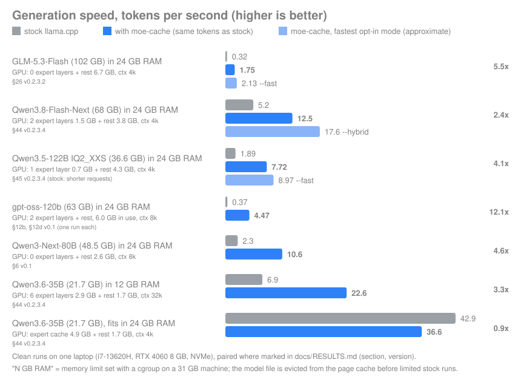

<h1 align="center">moe-cache</h1>

<p align="center"><b>Run Mixture-of-Experts models that are bigger than your RAM, without the speed cliff.</b><br>
A plugin for an unmodified <code>llama-server</code>. No fork, no patch.</p>

<p align="center">


<a href="https://ko-fi.com/ibrumm"></a>
</p>

<p align="center"></p>

## Why

MoE models such as Qwen3, gpt-oss or DeepSeek only use a few "experts" per token, but stock llama.cpp keeps all expert weights in memory-mapped files.
When they do not fit in RAM, the OS page cache thrashes and speed falls off a cliff.

moe-cache manages the CPU-side experts itself:

- keeps the **hot experts in RAM** and reads the rest from your SSD with large, parallel direct reads;
- **sizes its cache from your real memory limit** and stays under it (no out-of-memory kills);
- **learns which experts you use** and warm-starts from that next time (`moe-cache-learn` builds a profile in a minute);
- produces **token-identical output** to stock llama.cpp (checked on every model in [RESULTS](docs/RESULTS.md); the Hunyuan test was short only);
- works with speculative decoding (MTP; it helps when the model or most of it fits: Qwen3.6 at 12 GB 21.7 -> 24.0 tok/s, but it was 17 % slower on Qwen3.8-Flash-Next with an 8 GB card), split GGUF files, MXFP4 / K-quants / IQ4_XS / Q5_0, CPU-only machines and Vulkan GPUs;
- runs long prompts on the GPU like stock llama.cpp does;
- **expert executor** (on by default): while missing experts load from the SSD it already computes the ones in RAM, and on hybrid Intel CPUs it can use the efficiency cores too. Results are bit-identical (every output was compared byte for byte with llama.cpp's own on the test models);
- **faster Q2_0 kernel**: llama.cpp has no SIMD Q2_0 dot product on x86; the plugin supplies one (bit-identical, about 3x faster), which matters for models whose down projections are Q2_0 (for example Qwen3.8-Flash-Next).

### When to use something else

| Your situation | Best choice |
|---|---|
| The model **fits in your RAM** | **Stock llama.cpp**, ideally with its GPU expert cache (`--moe-cache-mib N`). On Qwen3.6-35B (21.7 GB) at a 24 GB limit, both with the same 5000 MiB GPU cache: stock 42 tok/s, moe-cache 30-34 (RESULTS section 29). moe-cache adds nothing here but its CPU pinning, which stock gets with `-C MASK --cpu-strict 1`. |
| You want **Qwen3.8-Flash-Next or Qwen3.6-35B as fast as possible** and have **12 GB+ VRAM and 32 GB+ RAM** | [Strata](https://github.com/Niko1221/Strata), an engine built for those models (its authors report 94 tok/s on an RTX 5070). |
| The model is **bigger than your RAM**, or it is **another MoE architecture**, or you want to stay on **stock llama.cpp with the same tokens** | **moe-cache**: 2x to 12x stock decode speed in our Linux measurements (table below; the 12x is the oldest row, gpt-oss-120b; the clean runs since 2026-10-15 are 2.4x to 5.2x). On Windows it is about equal to stock or slower in decode today, faster in prefill (see Hardware and OS support). |

## Get started

**You need:** Linux on x86-64 (Windows 11 is experimental: [docs/WINDOWS_TEST.md](docs/WINDOWS_TEST.md)), a `llama-server` built with shared ggml libraries (tested with llama.cpp commits `23b0202a1` (ggml 0.26.0, backend API 3) and `7fe450e19` (ggml 0.25.1, API 2); each needs its own plugin build, see [docs/QUICKSTART.md](docs/QUICKSTART.md)), and a MoE model as a `.gguf` file. A GPU is optional.
Ollama user? The models in `ollama list` are plain GGUF files: the path is on the line starting with `FROM` in `ollama show NAME --modelfile`.

### 1. Install (pick one)

| | Best if | What you do |
|---|---|---|
| **A. Prebuilt** (2 minutes) | you already have a matching `llama-server` (Arch `llama.cpp-cuda`, a build from commit 7fe450e19) | download `moe-cache-vX.Y.Z-linux-x86_64.tar.gz` from [Releases](https://github.com/IbrahimSiddiqui007/moe-cache/releases), then `tar xzf` it and `cd` into the folder. Releases built by CI can be verified: `gh attestation verify FILE.tar.gz -R IbrahimSiddiqui007/moe-cache` |
| **B. One script** (10 to 20 minutes) | fresh Ubuntu / Debian, nothing installed | `git clone https://github.com/IbrahimSiddiqui007/moe-cache && cd moe-cache && ./install.sh` (add `--vulkan` for AMD / Intel / NVIDIA through Vulkan). It builds the matching llama.cpp and the plugin and prints the next commands. It has only been tried on Arch with `--no-apt` so far: please report problems. |
| **C. From source** | you want to build it yourself | `git clone ... && cd moe-cache && ./build.sh` (needs g++; finds `libggml-base.so` next to your llama-server, or set `GGML_LIB_DIR`) |

### 2. Check your setup (changes nothing)

```bash
bin/moe-cache-check /path/to/model.gguf --llama-server /path/to/llama-server
```
Every line says OK, WARN or FAIL and what to do about it. Add `--run` to also start llama-server with the plugin for one short request (about a
minute): "cache runs: yes" means the cache really computed on your machine.

### 3. Run your model

```bash
bin/moe-cache-server /path/to/model.gguf --ram 12 --llama-server /path/to/llama-server --open
```
`--ram 12` is the memory (GB) it may use; leave it out to use what is free. Add `--fast` for about +10 % on models much bigger than your RAM, at the cost of output that is no longer identical to stock (the launcher suggests it when it would help); `--fast=2` is a stronger level for memory far below the model size (Flash-Next at 12 GB: +43 % over `--fast`, same answers in different words). The launcher plans the GPU/CPU split from your free VRAM, starts `llama-server` with the plugin and opens the chat page
(the same address, `http://localhost:8080`, is an OpenAI-compatible API for editors, Open WebUI and scripts).

For coding agents (OpenCode, Hermes Agent) add `--agent` (65k context, tool calls, warm sessions), then `python3 bin/moe_cache.py connect opencode --write`
(or `hermes`): see [docs/AGENTS.md](docs/AGENTS.md).

**Or use the control page** (new, step 1): `bin/moe-cache-server --ui` (Windows: double-click `bin\moe-cache-ui.bat`) opens http://127.0.0.1:8070, which
lists the models in `~/models` (and folders you add), says for each whether it fits in RAM, needs the cache or fits on the GPU and why, starts and
stops it, and shows live tok/s, cache hit rate, SSD reads, RAM, VRAM and the chat. See [docs/GUI.md](docs/GUI.md).

### 4. Optional: prove it is correct and measure it on your machine

```bash
tests/identity.sh /path/to/model.gguf --llama-server /path/to/llama-server      # PASS = the same tokens as stock llama.cpp
```

More detail, troubleshooting and the Vulkan build: [docs/QUICKSTART.md](docs/QUICKSTART.md).

## Results (measured, clean runs)

Re-measured on 2026-10-15 with the current code where the model is still on the test machine (RESULTS section 44); older rows say which version they come from.

| Situation | Stock llama.cpp | moe-cache | Measured with |
|---|---|---|---|
| **GLM-5.3-Flash (102 GB, 4x the memory limit)**, 24 GB RAM, 8 GB GPU | 0.32 tok/s | **1.75 tok/s** exact, 2.1 with `--fast` | v0.2.3.2 (§26) |
| **Qwen3.8-Flash-Next IQ2_XS (68 GB)**, 24 GB RAM, 8 GB GPU, launcher defaults | 5.2 tok/s | **12.5 tok/s**; 13.1 with `--gpu-cache auto`; 17.6 with `--hybrid` (approximate) | v0.2.3.5 (§44, §28, §31) |
| **Qwen3.5-122B-A10B**, 24 GB RAM, 8 GB GPU, launcher defaults: IQ2_XXS (36.6 GB) / IQ3_XXS (44.7 GB) / IQ4_XS (60.2 GB) | 1.89 / 1.10 / 0.91 tok/s | **7.7 / 5.7 / 3.7 tok/s** (4-5x, same tokens); 9.0 / 6.8 / 4.5 with `--fast` | v0.2.3.5 (§45) |
| **gpt-oss-120b (63 GB)**, 24 GB RAM, 2 expert layers on the GPU, ctx 8k, one run each | 0.37 tok/s | **4.47 tok/s** | v0.1 (§12b, §12d): stock and plugin from different sessions, stock flagged not clean; the clean all-CPU pair of §12 is 0.34 vs 2.71 (8x) |
| Qwen3-Next-80B (48.5 GB), 24 GB RAM, ~2.6 GB GPU use | 2.3 tok/s | **10.6 tok/s** | v0.1 (§6) |
| Same model, 20 GB RAM | 1.3 tok/s | **9.3 tok/s** | v0.1 (§6) |
| Qwen3.6-35B (21.7 GB), 12 GB RAM, 6 expert layers on the GPU | 6.9 tok/s | **22.6 tok/s** | v0.2.3.5 (§44) |
| Qwen3.6-35B, 12 GB RAM, **no GPU at all** | 3.1 tok/s | **9.9 tok/s** | v0.1 (§5) |
| **Model fits in RAM** (Qwen3.6-35B, 24 GB, warm) | **42.9 tok/s** | 36.6 tok/s | v0.2.3.5 (§44): the launcher now runs stock llama.cpp here |

### Prompt processing (prefill)

| Model, memory limit | Stock llama.cpp | moe-cache | Measured with |
|---|---|---|---|
| Qwen3.6-35B (21.7 GB), 12 GB RAM, 2-5k token prompts | 132.8 tok/s (2.4k prompt) | **136.5 tok/s** first prompt, **186 to 206 tok/s** on the next ones | v0.2.3.5 (§46) |
| Qwen3.8-Flash-Next IQ2_XS (68 GB), 24 GB RAM, 2-5k token prompts | 65.9 tok/s (2.4k prompt) | **90 to 103 tok/s** | stock v0.2.3.5 (§46), moe-cache v0.2.3.3 (§38) |
| Qwen3.8-Flash-Next IQ2_XS (68 GB), 24 GB RAM, context 8192, 2-6k token prompts | - | **93 to 135 tok/s** (two runs) | experimental 2026-10-26, with the tuner fix (§52) |

For long prompts llama.cpp already computes the experts on the GPU, so the prefill gain is smaller than the decode gain; it grows with how far the model
exceeds RAM. Bigger prompt chunks on a 12-16 GB card are the next step (BIGGER_MACHINES B13).

"Stock" is the same `llama-server` binary with the same command line (same context, same number of expert layers on the GPU through `--n-cpu-moe`, its default memory-mapped loading), only without the plugin. moe-cache does not replace `--n-cpu-moe`; it manages the experts that `--n-cpu-moe` leaves on the CPU.

Conditions: "RAM" is a memory limit set with a cgroup on a 31 GB machine; before every limited stock run the model file is dropped from the page cache (otherwise
stock can read it from cache that does not count against the limit and looks up to 4.6x faster than it is, RESULTS 44). One run per row unless the section says paired.
When the model fits in the memory llama-server may use, stock llama.cpp is faster (its page cache holds the whole file and stays warm across restarts), so
`moe-cache-server` starts stock llama-server then and says so.

**Tip for Intel 12th gen and newer laptops (performance + efficiency cores):** pin llama.cpp to one thread per performance core, e.g. `-C 0x555 --cpu-strict 1` on a 6-performance-core CPU (this alone gave stock llama.cpp +15 % decode speed on our laptop; `moe-cache-server` does it for you). Details in [docs/RESULTS.md](docs/RESULTS.md), section 11.

Methods, all numbers and every caveat: [docs/RESULTS.md](docs/RESULTS.md). Hardware for all measurements above: Intel i7-13620H, 31 GB RAM, RTX 4060 8 GB, NVMe SSD (a Ryzen 7 5800H mini PC in RESULTS 50; the Windows 11 desktop in RESULTS 54-55).

## Hardware and OS support

| Platform | Status |
|---|---|
| Linux + Intel CPU + NVIDIA GPU (CUDA) | **Tested** |
| Linux + Vulkan (NVIDIA, and the Intel integrated GPU) | **Tested** on llama.cpp `7fe450e19` only, loaded the official way (`GGML_BACKEND_PATH`; see the feature table below) |
| Linux, no usable GPU (CPU only) | **Tested**, identical to stock, within about 4 % of its speed when the model fits |
| Linux + AMD CPU, AMD integrated GPU (Vulkan) | **Tested** on a Ryzen 7 5800H with Vega 8 (2026-10-16): identical to stock, Qwen3.6 at 12 GB 1.23x stock (no expert layer fits on a 3 GiB iGPU); RESULTS 50 |
| Linux + AMD discrete GPU | **Tested by a user** (GitHub issue #1: RX 9070 XT + Ryzen 7 7700, Linux, Vulkan): identity PASS, Flash-Next 15.9 -> 18.8 tok/s. Not yet run by the developer on Linux |
| Windows | **Experimental.** Identical to stock with the cache on in CI on a Windows runner (official llama.cpp CPU release) since 2026-10-16, and on real hardware with a GPU since 2026-10-26: Windows 11 desktop, Ryzen 9 7950X + RX 9070 XT, Vulkan, identity 4/4 on four models (RESULTS 54). Speeds there (RESULTS 55, file cache flushed before every run): Flash-Next decode about equal to stock (12.2 vs 12.1-16.1 tok/s), prefill 2.2x; Qwen3.5-122B decode **about half of stock** (about 6.5 vs 11-14 tok/s, cause under investigation), prefill 1.5x. So on Windows today the gain is long prompts, not decode. On AMD's Windows driver the launcher keeps all experts on the CPU for models bigger than RAM (VRAM in use also costs system RAM) and turns off context checkpoints for Flash-Next (they crash the driver). See docs/COMPATIBILITY.md |
| macOS | No |

## Benchmark it on your own model and your own use case

The benchmark tool (web page, standard protocol, many-model matrix, quality harness) now lives in its own repository: [moe-cache-benchmark](https://github.com/IbrahimSiddiqui007/moe-cache-benchmark).
Clone it next to this folder (or set `MOE_CACHE_DIR`) and it finds the plugin and the planner by itself.

## How it works

```
 llama.cpp builds the graph of the model
          |
  ggml scheduler hands each operation to a backend
          |
   +------+------------------+
   |  GPU backend            |  attention, norms, shared layers, the experts you put on the GPU
   |  CPU backend            |  everything else
   |  moe-cache backend  <-----+  the CPU-side expert matrix multiplications:
   +-------------------------+    1. look at which experts the router picked
                                  2. make sure those experts are in RAM (read the missing ones from the SSD, in the background)
                                  3. compute the experts that are ready while the others still load (several threads, optionally efficiency cores)
                                  4. give back the memory of experts nobody needs (LRU)
                                  5. use llama.cpp's own dot-product functions, so every number is identical
```

Each expert keeps its normal address inside one large reserved block of memory; moe-cache decides which experts have real memory behind them.
It plugs into **ggml**, not into llama.cpp's model code, so a model that llama.cpp runs through its expert multiplication should work; the architectures that were actually tested are listed in [COMPATIBILITY](docs/COMPATIBILITY.md) and [RESULTS](docs/RESULTS.md).

## Known limitations

- Long prompts (32+ tokens per batch) run their expert blocks on the GPU, as stock llama.cpp does, so prompt processing is at stock speed when the model fits (DeepSeek-V2-Lite: 166 to 183 tok/s vs 166 to 188 stock) and much faster when memory is short.
- It does not manage the GPU; which layers' experts sit in VRAM is chosen once at start by the planner. A GPU expert tier was evaluated and is not built, see [docs/ENGINE_DECISION.md](docs/ENGINE_DECISION.md).
- **Not every feature works with every llama.cpp build.** How the plugin is loaded depends on how llama.cpp was built (`moe-cache-server` picks it):

  | Feature | `LD_PRELOAD` (llama.cpp that links its backends directly: distro packages, your own CUDA build) | `GGML_BACKEND_PATH` (backends as separate files: official releases, `./install.sh`, Vulkan builds, Windows) |
  |---|---|---|
  | RAM expert cache, SSD streaming, memory limit, warm start | yes | yes |
  | Expert executor (computes ready experts while others load) | yes | yes (since 0.2.3.3; tested on a Vulkan build) |
  | Fast Q2_0 / IQ3_XXS kernels | yes | inside the executor only (Linux; the Windows build has none of the plugin's own CPU kernels) |
  | Working together with llama.cpp's GPU expert cache (`--gpu-cache`) | yes | yes since I28 (the plugin rewrites llama.cpp's import of the upload function; the launcher adds `--no-op-offload`) |

  The `moe-cache: active: ...` line in the server log says which parts are on.
- Needs a llama.cpp with shared ggml libraries; tested with commits `23b0202a1` (ggml 0.26.0) and `7fe450e19` (ggml 0.25.1). The plugin refuses to load into a ggml with a different backend API than it was built for (it prints why and the model loads normally). Linux; Windows is experimental (identity-tested on a Windows 11 + RX 9070 XT desktop and in CI, see [COMPATIBILITY](docs/COMPATIBILITY.md) and the [Windows quick start](docs/WINDOWS.md)).

## FAQ

**Do I need this if my model fits in RAM?** No. Use stock llama.cpp with `--moe-cache-mib` (see "When to use something else" above). The gain is when memory is short or the model is larger than your RAM. _work in progress though, I'm currently seeing different ways to improve speed and efficiency_

**Why is it not faster when my model already fits in RAM?** Because there is nothing to fix: stock llama.cpp then runs from the page cache with the same kernels. On Qwen3.6-35B at 24 GB, decode needs about 0.5 GB of expert weights per token (8 experts x 32 CPU layers x 1.9 MB), which the memory bus delivers at about 35 GB/s, close to this laptop's measured maximum (40 GB/s), so it is bandwidth-bound for everyone (stock 40, moe-cache 40 tok/s). The speed-ups appear when memory is short (the same model at 12 GB: 10 to 23 tok/s), for models larger than RAM, and for models with slow kernels (Q2_0 and the IQ types, where the executor and the faster kernel help).

**Does it use my GPU?** Yes, through llama.cpp as usual. `moe-cache-server` picks how many layers' experts live on the GPU from your free VRAM (that alone is worth about +60 % over keeping everything on the CPU). moe-cache itself manages the experts that stay on the CPU side.

**Is the output really the same as stock?** Yes by default: `tests/identity.sh` compares the tokens of stock llama-server and llama-server with the plugin (temperature 0, seed 42, same command line) and every model in [RESULTS](docs/RESULTS.md) passed it (Hunyuan only a short test). It runs in CI on Linux and Windows. Only `--fast`, `--fast=2` and `--hybrid` change the output, and only when you ask for them.

**Why not just let the OS page cache / mmap handle it?** That is what stock llama.cpp does, and it is the slow case in the table: when the model does not fit, missing experts come in through tens of thousands of small page faults per token, and the kernel evicts pages without knowing which experts matter. moe-cache reads the same bytes with a few hundred large parallel direct reads and keeps whole experts (gpt-oss-120b: about 79,000 vs 770 reads per token for the same 325 MB, RESULTS 12b). `--no-mmap` or `--mlock` need the whole model in RAM, so they do not help a model bigger than RAM.

**How does it compare with ktransformers, ik_llama.cpp or PowerInfer?** Not measured. Those are separate engines (forks or rewrites with their own kernels and model support); moe-cache is a plugin for the unmodified upstream llama-server and keeps its exact tokens. Against llama.cpp's own `--n-cpu-moe` / `-ot` offload: moe-cache works together with it (every row above uses the same `--n-cpu-moe` on both sides).

**Does it work with Ollama or LM Studio?** Not directly: both ship their own bundled copy of llama.cpp, and the plugin needs a `llama-server` built with shared ggml libraries from a tested commit. Their model files are plain GGUF, so you can run the same file with `moe-cache-server` (see "Ollama user?" above) and point any OpenAI-compatible client at `http://localhost:8080/v1`.

**On Windows llama-server uses a lot of RAM with GPU layers, should I add `--no-mmap`, `--mlock` or `--moe-cache-mib`?** No. llama.cpp's Windows loader leaves the model-file pages of the GPU tensors in llama-server's working set (about as much RAM as the GPU layers; RESULTS 56 I37). It is not the GPU driver. The plugin releases those pages at the first graph (the log says "released N GiB of model-file pages from the working set"). `--moe-cache-mib` is llama.cpp's GPU cache, not this plugin's. A small page file also limits the cache. Details: [docs/WINDOWS.md](docs/WINDOWS.md), "Windows: where the RAM goes".

**Mac?** No. The plugin uses Linux (and Windows) memory and direct-I/O calls, and on Apple Silicon the GPU and CPU share one memory, which changes the problem.

**Does it wear out my SSD?** It only reads the model file; reads do not wear an SSD. It writes small files: the expert profile, and in `--agent` mode the saved conversations (`--no-warm` turns that off).

**Is there a GUI?** Yes: the control page (`bin/moe-cache-server --ui`, see [docs/GUI.md](docs/GUI.md)), plus llama-server's own chat page (`--open`). Any OpenAI-compatible app such as [Open WebUI](https://github.com/open-webui/open-webui) can use `http://localhost:8080/v1` (we have not tested Open WebUI ourselves).

**Why not an own inference engine like Strata or Maya?** Short answer: they are single-model engines with a high hardware floor; moe-cache is a small layer for the MoE models llama.cpp runs (tested list in COMPATIBILITY). The reasoning and our measurements: [docs/ENGINE_DECISION.md](docs/ENGINE_DECISION.md).

## Documentation

[Quick start](docs/QUICKSTART.md) | [Coding agents](docs/AGENTS.md) | [Control page](docs/GUI.md) | [Benchmarks](https://github.com/IbrahimSiddiqui007/moe-cache-benchmark) | [Results](docs/RESULTS.md) | [Compatibility](docs/COMPATIBILITY.md) | [Roadmap](docs/ROADMAP.md) | [Engine decision](docs/ENGINE_DECISION.md) | [Security and privacy](docs/SECURITY.md)

## Configuration (environment variables; `moe-cache-server` sets them for you)

| Variable | Meaning |
|---|---|
| `MOE_CACHE_SIZE_GIB` | cache size in GiB, or `auto` (size from the memory limit) |
| `MOE_CACHE_RAM_GIB`, `MOE_CACHE_MARGIN_GIB` | override the detected memory limit; memory to keep free (default 1 GiB) |
| `MOE_CACHE_GGUF` | model file (split models: the first part) |
| `MOE_CACHE_PROFILE` / `MOE_CACHE_WARM` | learn expert usage here and warm-start from it / warm start only |
| `MOE_CACHE_STATS=1` | print hit rate, reads and evictions at exit |
| `MOE_CACHE_STATS_SIGNAL=1` | print one `moe-cache-stats {json}` line of the running counters on request: Linux `kill -USR1 <pid>`, Windows set the named event `Local\moe-cache-stats-<pid>` |
| `MOE_CACHE_DISABLE=1` | load nothing: the server behaves exactly like stock |
| `MOE_CACHE_EXEC=0` | switch the expert executor off (default on) |
| `MOE_CACHE_EXEC_ECORES=N` | let the executor use N efficiency cores as well (the launcher sets up to 4 on hybrid Intel CPUs; `--no-ecores` to disable) |
| `MOE_CACHE_EXEC_THREADS=N`, `MOE_CACHE_EXEC_READERS=N` | compute threads (default: what llama.cpp asks for) and background reader threads (default 4) |
| `MOE_CACHE_EXEC_CHECK=1` | recompute every expert op the stock way and compare (slow; for testing) |
| `MOE_CACHE_FAST_KERNELS=0` | use llama.cpp's own Q2_0 kernel instead of the plugin's |
| `MOE_CACHE_IQ3_KERNEL=1` / `=0` | use the plugin's IQ3_XXS gather kernel (bit-identical) on any AVX2 CPU / turn it off; off by default on AMD, where gathers are slow (Zen 4: about 0.6x llama.cpp's own function) |
| `MOE_CACHE_ROUTE=skip` (`moe-cache-server --fast`; `--fast` also sets a q8_0 KV cache, KL 0.0045 alone) | opt-in approximate routing: skip a low-ranked expert that is not in RAM. About +10-12 % when the model is much bigger than RAM; about 1 top token in 40-50 differs from stock (KL 0.005-0.012; RESULTS section 31). Off by default |
| `MOE_CACHE_HYBRID=MiB\|auto` (`moe-cache-server --hybrid`) | opt-in, experimental: a bank of the most used experts (from the usage profile) in free GPU memory computes those picks while the CPU computes the rest. Flash-Next on 8 GB: 13.1 -> 17.4 tok/s; KL 0.0043 vs exact (about 1 top token in 60 differs). Needs a usage profile (the first session has none). The bank adapts to the session (`MOE_CACHE_HYBRID_ADAPT=N,K`, default 8,16; 0 = keep the profile choice). For models whose experts are slow on the CPU (IQ / Q2_0 quants); with Q4_K-class models such as Qwen3.6 it is slower than `--gpu-cache` (8.7 vs 15.7 tok/s at 12 GB). Off by default |
| `MOE_CACHE_ROUTE_DROP=N`, `MOE_CACHE_ROUTE_KEEP=N` | with `ROUTE=skip`: how many of the lowest-ranked picks may be skipped (default 2; `--fast=2` sets 4, with at least half of the picks always kept) |
| `MOE_CACHE_COALESCE_MIB=N` | merge neighbouring expert reads of a long prompt into reads of up to N MiB (default 16; 0 = off). Flash-Next prefill +14-24 % |
| `MOE_CACHE_SCAN_TOKENS=N` | prompt batches of N+ tokens load experts at the evict-first end, so the cache from before a long prompt survives it (default 512; 0 = off). Flash-Next prefill +27 % |
| starter profiles (`moe-cache-server --no-starter` to skip) | with no usage profile yet, the launcher starts from the shipped one for the model family (`profiles/`): first request 2.1x faster on Flash-Next (RESULTS 53) |
| `MOE_CACHE_GPU_PACK=0` | turn off packing: by default a long-prompt block uploads only the experts its tokens use (exact; 70-token prompts 1.8x faster on Qwen3.6, RESULTS 52) |
| `MOE_CACHE_HOST_RESERVE_MIB` | memory kept free for llama-server's prompt cache (`--cache-ram`); the launcher sets it |
| `MOE_CACHE_GUARD=1` | tests only: reading an evicted expert crashes instead of returning zeros (small models only) |

## Support

moe-cache is built and tested in my spare time on my own machines. If it saves you a RAM upgrade, you can support it on [Ko-fi](https://ko-fi.com/ibrumm).

## Acknowledgements

- [llama.cpp](https://github.com/ggml-org/llama.cpp) and ggml (MIT, Copyright The ggml authors): moe-cache is a plugin for their backend interface, and it runs their CPU kernels unchanged.
- Related projects with a similar approach (tiering experts across VRAM, RAM and SSD), built as single-model engines: [Strata](https://github.com/Niko1221/Strata) (MIT, by Niko1221) and [Project Maya](https://github.com/mw00/project-maya) (MIT, by mw00).

## License

- moe-cache is MIT-licensed, see [LICENSE](LICENSE).
- `third_party/ggml/` contains interface headers copied from ggml / llama.cpp (MIT, Copyright The ggml authors). Their license text is kept in `third_party/ggml/LICENSE`.
- moe-cache does not include any model weights. Models you run with it keep their own licenses.
- Product and model names (Qwen, gpt-oss, DeepSeek, Granite, Hunyuan, KAT-Coder and others) belong to their owners and are used only to say what was tested.
