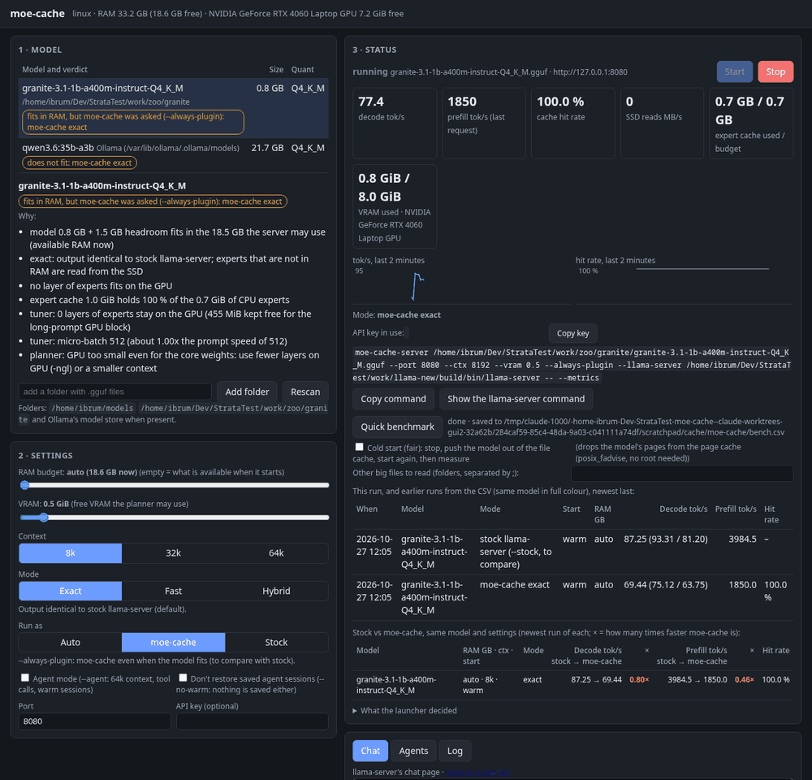
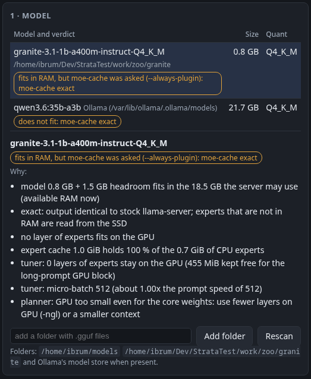
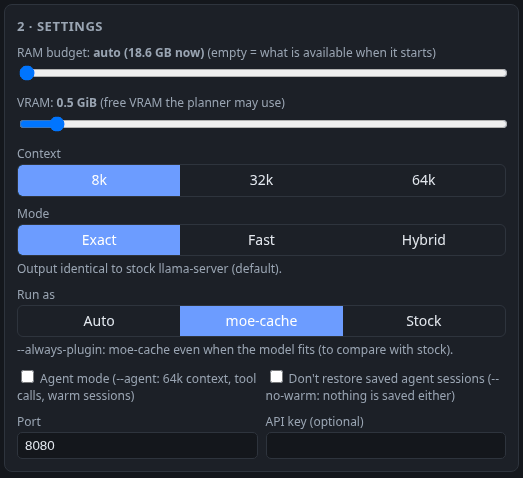
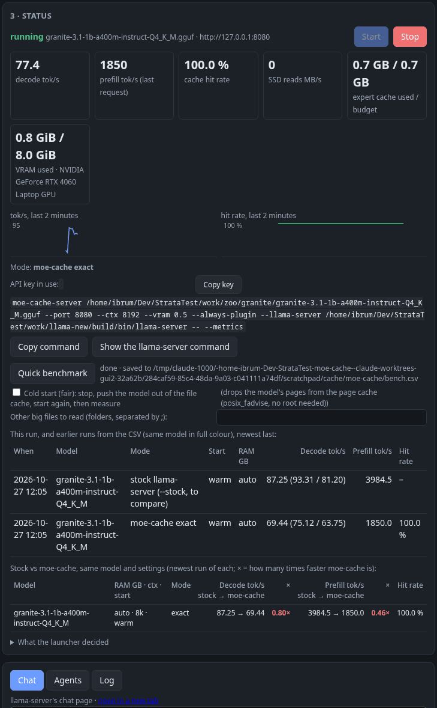
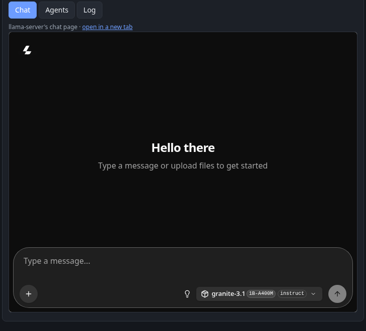
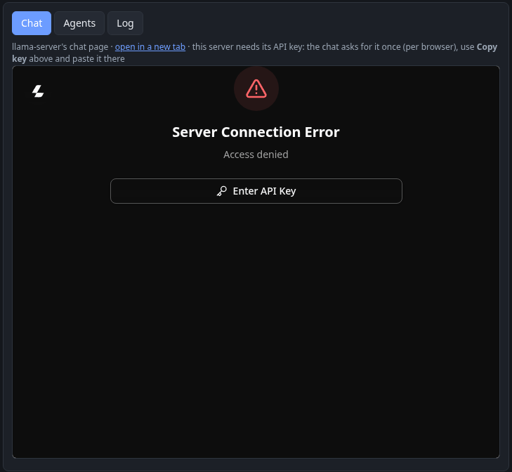
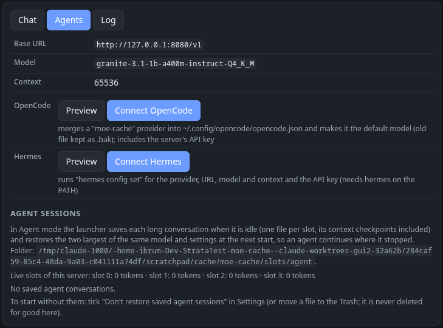

# Control page: user guide

The control page is a small web page on your own computer. It lists your models, tells you for each one whether it fits in memory and how
moe-cache would run it (and why), starts and stops the model, and shows how fast it runs. It comes with the launcher: plain Python, nothing to
install, the same on Linux and Windows.

## 1. Start it

| System | How |
|---|---|
| Linux | `bin/moe-cache-server --ui` |
| Windows | double-click `bin\moe-cache-ui.bat` |
| Windows, Start menu | run `bin\moe-cache-ui.bat --shortcut` once; then start "moe-cache" from the Start menu |
| Either, by hand | `python bin/moe_cache.py ui` (Windows: `python bin\moe_cache.py ui`) |

Your browser opens the page. The terminal shows its address, which looks like `http://127.0.0.1:8070/?t=…`. The part after `?t=` is a password for
this run: only someone who has it can use the page (see section 10). If the browser did not open, copy that whole address into it.

**Stop it** with Ctrl-C in the terminal (or close the `.bat` window). That also stops any model the page started.

Options (for all ways of starting):

| Option | Meaning |
|---|---|
| `--ui-port N` | use another port for the page (default 8070) |
| `--llama-server PATH` | the llama-server program to start (default: the `LLAMA_SERVER` variable, else `llama-server` on the PATH) |
| `--no-browser` | do not open the browser |

**What the Windows `.bat` finds by itself** (set the variable yourself to choose):

| Piece | Where it looks, in this order |
|---|---|
| Python | `MOE_CACHE_PYTHON`, the `py` launcher, a `python.exe` that really runs |
| The plugin (`MOE_CACHE_LIB`) | `ggml-moe-cache-api3.dll` or `ggml-moe-cache.dll` next to the `.bat` or one folder up, then `build\win-api3\`, `build\win\` |
| llama-server (`LLAMA_SERVER`) | on the PATH, then `C:\llama\llama-server.exe` |

It prints what it found. The same is shown in the page's header when you hold the mouse over it.

## 2. The page at a glance

*(Granite 1B on the test laptop, Linux, RTX 4060 8 GB, 2026-10-27; VRAM set to 0.5 GiB so the experts stay on the CPU and the cache has work to do.)*

| Panel | What it is for |
|---|---|
| **1 · Model** (left, top) | pick a model; see if it fits and how it would run |
| **2 · Settings** (left, bottom) | memory budgets, context, mode, agent mode, port, API key |
| **3 · Status** (right, top) | Start / Stop, live speed and memory, what the launcher decided, warnings, Quick benchmark |
| **4 · Chat / Agents / Log** (right, bottom) | chat with the model, connect coding agents, saved agent sessions, the server's log |

Add `#agents` or `#log` to the page's address to open that tab directly (handy as a bookmark).

## 3. Models and the plan

The list shows every `.gguf` file in your model folders: `~/models` (on Windows also `C:\models`), any folder you add with **Add folder**, and
Ollama's model store if you have Ollama. A model split into several files is listed once. **Rescan** reads the folders again.

Each model shows its size, its quantisation (for example `Q4_K_M`) and a verdict:

| Verdict | Meaning |
|---|---|
| **fits in RAM: stock llama-server (fastest)** | the model plus 1.5 GB fits in the memory it may use: the launcher runs plain llama-server without the plugin, which is faster when everything fits |
| **does not fit: moe-cache exact** | the model is bigger than that: the plugin keeps the most used experts in RAM and reads the rest from the SSD; the answers are exactly the same as stock llama-server's |
| **does not fit: moe-cache --fast** / **--hybrid** | the same, with the faster but approximate mode you picked in Settings |
| **all experts fit on the GPU** | every expert fits in your graphics card's memory: nothing for the cache to do |
| **cannot plan this model** | the planner could not read it (for example not a MoE model); the reason is shown |

Click a model to see **Why**: the numbers behind the verdict (model size against your memory, how many layers of experts go on the GPU, how much
of the experts the cache can hold, the micro-batch). On Windows with an AMD graphics card it also lists the launcher's AMD rule
(`--ctx-checkpoints 0` for Flash-Next on older drivers), in purple. For models we have measured, it also lists the
speeds we measured on our test laptop (yours will differ).

The verdict uses the same rules and planner as the launcher, so it matches what **Start** will do.

## 4. Settings

| Setting | What it does | Default |
|---|---|---|
| RAM budget | the memory (GB) the model may use (`--ram`) | empty: what is free when it starts |
| VRAM | graphics memory (GiB) the planner may use (`--vram`) | auto: detected at start |
| Context | how much text the model keeps in view: 8k, 32k or 64k tokens | 8k (64k in Agent mode) |
| Mode | **Exact**: answers identical to stock llama-server. **Fast** (`--fast`): skips rarely needed experts that are not in RAM, about +10 % speed, about 1 token in 40-50 differs. **Hybrid** (`--hybrid`, experimental): most used experts on the GPU, the rest on the CPU, answers differ from stock | Exact |
| Run as | **Auto**: stock llama-server when the model fits in RAM (faster then), moe-cache when it does not. **moe-cache** (`--always-plugin`): the plugin even when the model fits. **Stock** (`--stock`): no plugin even when the model does not fit (Mode is Exact then). The last two are for comparing the two on your machine (section 9) | Auto |
| MTP | multi-token prediction with the model's own draft head (Qwen3.6, GLM-5.3 have one): same answers, faster replies (Qwen3.6 on the desktop PC: +54 % decode). **Auto**: on in Agent mode when the model has the head and your llama-server supports it. **On** (`--mtp`) / **Off** (`--no-mtp`). The plan's Why list says what will happen; the Status panel shows "+ MTP" when it is on. GLM on Windows: MTP currently fails at load (being fixed), choose Off there | Auto |
| Agent mode | for coding agents (`--agent`): 64k context, tool calls, saved conversations, an API key | off |
| Don't restore saved agent sessions | starts without the saved conversations (`--no-warm`); then nothing is saved either | off |
| Port | where llama-server listens | 8080 |
| API key | a key of your own for llama-server (optional); it wins over the launcher's | empty |

Changing a setting updates the verdicts. The page remembers your last settings (not the API key).

## 5. Start, stop and the live numbers

*(Granite fits in RAM, so stock llama-server is faster here, 0.80× and 0.46× in red: as the launcher's Auto choice says. The gain is for models
bigger than RAM.)*

**Start** starts the selected model with your settings, through the launcher (`moe_cache.py server`). **Stop** stops it. The model loads in a
few seconds to a few minutes; the state shows *starting…* until it is ready.

| Number | Meaning |
|---|---|
| decode tok/s | how fast it writes: live while it answers, else the last answer |
| prefill tok/s | how fast it read the last prompt |
| cache hit rate | share of experts found in RAM (plugin only); higher is better |
| SSD reads MB/s | how much it reads from the disk right now (plugin only) |
| RAM | the expert cache's use and budget (plugin), or llama-server's memory (stock) |
| VRAM | graphics memory used (NVIDIA; AMD on Linux; AMD/Intel on Windows through the launcher's GPU check) |

The two small charts show speed and hit rate over the last 2 minutes.

**Mode** says what the launcher chose (stock, moe-cache exact, …). **What the launcher decided** lists its own messages from before it started
llama-server: stock or plugin and why, GPU layers, micro-batch, CPU pinning; on Windows also the GPU it found, the memory limit and the AMD
rules (highlighted). **Warnings** collects warning lines from the log (for example "the expert cache shrank", "the plugin disabled itself", why
the server stopped), each shown once with a count.

**Copy command** copies the launcher command for these settings; **Show the llama-server command** asks the launcher what it would run (without
running it).

## 6. Chat

The **Chat** tab shows llama-server's own chat page once the model is ready (or open it in a new tab with the link). In Agent mode the server needs
its API key: the chat page asks for it once per browser; press **Copy key** in the Status panel and paste it there.

## 7. Coding agents (OpenCode, Hermes)

Start the model with **Agent mode** on. The **Agents** tab then shows the base URL (`http://127.0.0.1:8080/v1`), the model name and the context.

| Button | What it does |
|---|---|
| **Preview** | shows what would be written, changes nothing |
| **Connect OpenCode** | adds a "moe-cache" provider to `~/.config/opencode/opencode.json` and makes it the default model (the old file is kept as `.bak`); shows the block now in the file |
| **Connect Hermes** | runs `hermes config set` for provider, URL, model, context and key (needs `hermes` on the PATH) |

Both include the server's API key, so the agent works right away. More on agents (desktop apps, speed): [AGENTS](AGENTS.md).

**API key in agent mode.** Agent servers keep your conversations on disk, so the launcher protects them with an API key: one random key per
user, made on first use and kept in the cache folder (`python bin/moe_cache.py key` prints it). The Status panel shows **API key in use: ••••abcd**
(its last 4 characters) and a **Copy key** button. The page never puts the key in an address or the log. A key you type in Settings is used
instead. Plain chat servers (Agent mode off) have no key unless you type one; the launcher lets only pages from your own machine (localhost)
talk to them from a browser.

## 8. Saved agent sessions

In Agent mode the launcher saves each long conversation when it is idle and, at the next start, restores the two largest of the same model and
settings, so an agent continues where it stopped. The **Agents** tab lists them:

| Column | Meaning |
|---|---|
| Saved conversation | model, context and KV type it belongs to |
| Slot, Tokens, Size, Saved | which server slot, how long the conversation is, file size, when it was saved |
| Agent | OpenCode, Hermes, … guessed from the start of the conversation (only while its model runs) |
| State | **restored at start**, for this server's model and settings, another model or setting, or restore failed |

It also shows the server's live slots. **Move to Trash** sends a saved conversation to the Trash (Windows: Recycle Bin); it is never deleted for
good here, and you can restore it from the Trash. To start once without them, tick **Don't restore saved agent sessions** in Settings.

The files are in `~/.cache/moe-cache/slots/agent/` (Windows: `%USERPROFILE%\.cache\moe-cache\slots\agent\`).

## 9. Quick benchmark

With a model running, **Quick benchmark** measures it the way our own speed tests do: a short warm-up, two answers of 256 tokens and one prompt of
about 3,500 tokens (fixed settings, so runs compare). It takes one to a few minutes and shows decode speed (both answers and the mean), prefill
speed and, with the plugin, the cache hit rate. Every run is added to `bench.csv` in the cache folder and shown next to earlier runs.

**Compare stock and moe-cache on your machine:** set **Run as** to **Stock**, start, run the benchmark; stop, set **Run as** to **moe-cache**
(or Auto for a model bigger than RAM), start, run it again. Leave everything else the same. A table **Stock vs moe-cache** then shows the newest
run of each side by side, with how many times faster moe-cache was (decode and prefill, green when faster). It also appears when you open the
page, from the runs saved before.

A RAM budget limits moe-cache only: stock llama-server still uses all free RAM through the file cache, so a comparison with a RAM number favours
stock (the page says so under the table). The fair test is RAM on **auto** with a model bigger than this computer's RAM.

**Cold start (fair).** A model you used a moment ago is still in the operating system's file cache, which makes stock llama-server look faster
than on a first start. Tick **Cold start** and the benchmark stops the server, pushes the model out of the file cache, starts it again and then
measures. The row says `cold` or `warm`, how long the start took and how the flush went.

| System | How the model leaves the file cache |
|---|---|
| Linux | the page tells the system to drop the model's cached pages (no root needed). It refuses while another program uses the model file, so that program is not slowed down |
| Windows | `tools\win_flush_cache.ps1` reads other big files until the cache no longer holds the model; it only reads. Pick folders with other big files (default: your model folders); with too little data the row says the flush was partial |

For a fair stock number with a model bigger than your RAM on Linux, also give the run a memory limit, as the README's "Conditions" explain.

## 10. Safety

The page can start programs, so it only answers you:

| Protection | Keeps out |
|---|---|
| it listens on 127.0.0.1 only | other computers |
| the password in the address (`?t=…`), new for every run, kept in a cookie only this page gets | other users of the same computer |
| it checks where each request comes from | web sites open in your browser |
| it cannot be shown inside another site's frame | click tricks by other sites |
| only listed models can be started; the API key never goes on a command line or into an address | misuse |

If you open the page without the password you see a short note: open the address the terminal printed.

## 11. Troubleshooting

| Problem | What to do |
|---|---|
| "port 8080 is already in use" when you press Start | another server runs on that port (maybe one you started by hand): stop it, or pick another **Port** in Settings |
| the page does not start: "cannot listen on 127.0.0.1:8070" | another control page is open: use it, or start with `--ui-port 8071` |
| the page says "Open the address the launcher printed" | you opened it without the `?t=…` part: copy the full address from the terminal |
| "No .gguf models found" | **Add folder** with your models, then **Rescan** |
| the header says "no GPU found", or the plan says "no GPU with its own memory found" | NVIDIA: does `nvidia-smi` work? AMD or Intel on Windows: the page asks llama-server (`--list-devices`) at start, which takes a few seconds, and needs a Vulkan build of llama.cpp. An integrated GPU is used without dedicated VRAM on purpose. You can also set **VRAM** by hand |
| warning "the plugin did not load: llama-server is running stock llama.cpp" | the plugin does not match this llama-server or was not found: run `python bin/moe_cache.py check MODEL --llama-server PATH`, which says why; on Windows set `MOE_CACHE_LIB` to the right DLL (api3 for current llama.cpp releases) |
| warning "the plugin loaded but disabled itself" | the warning and the **Log** tab say why |
| the model stops right after Start (state "ended") | open the **Log** tab: the last lines say why (out of memory, a wrong argument, a crash) |
| the chat asks for an API key | Agent mode is on: press **Copy key** and paste it into the chat |
| hit rate and SSD reads stay "–" | the model runs stock (it fits in RAM): there is no cache to measure |
| "Cold start: not available" | not supported on this system (Windows needs `tools\win_flush_cache.ps1` and PowerShell) |
| cold start: "another program uses this model file" | another program (another llama-server, Ollama) has the model open: stop it first, or run a warm benchmark |

## 12. For developers

- Code: `bin/moe_cache_ui.py` (the page server, standard-library Python) and `ui/index.html` (the page, plain JavaScript).
- The verdict uses the launcher's own rules: `planner/plan.py --json`, `planner/gguf_plan.py tune()` and the stock rule (model + 1.5 GB against
  the memory it may use).
- Live numbers: the plugin's stats snapshot (`MOE_CACHE_STATS_SIGNAL`: SIGUSR1 on Linux, sent only when llama-server has the plugin's handler;
  the named event `Local\moe-cache-stats-<pid>` on Windows), llama-server's `/slots` and its timing lines. No change to the plugin or llama.cpp.
- Scripts can use the page's API with the header `X-MoeCache-Token: <the ?t= value>`.
- Tests: `tests/ui_test.py` (no model) and `tests/ui_live.py MODEL.gguf --llama-server PATH` (a real model); CI runs both on Linux and Windows.
- Not yet: model downloads, several models at once, remote access, a desktop app (design draft APP2).
